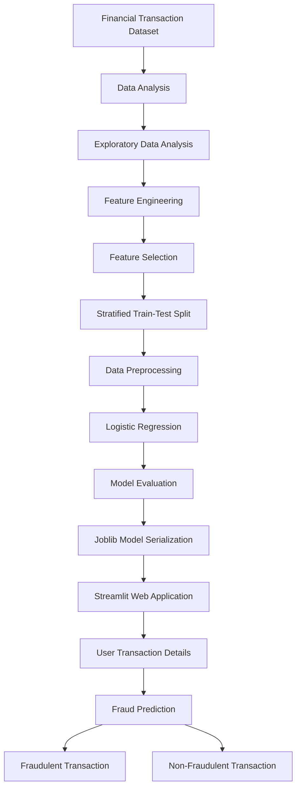
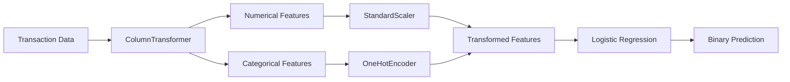
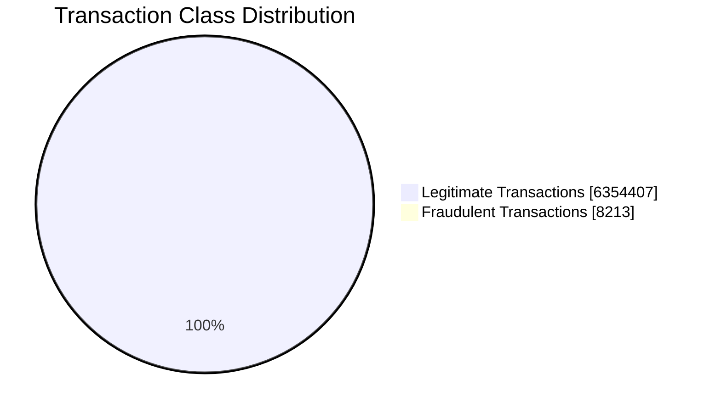
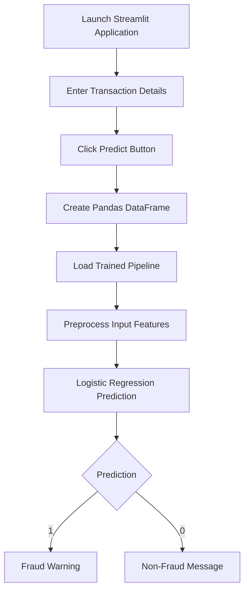

# 💳 Fraud Detection System Using Machine Learning


## 📌 Project Overview

The Fraud Detection System is an end-to-end machine learning application designed to identify potentially fraudulent financial transactions based on transaction details, transaction types, amounts, and account balance information.

The system uses Logistic Regression with class-weight balancing to address the highly imbalanced nature of financial transaction data.

The project includes Exploratory Data Analysis (EDA), feature engineering, data preprocessing, model training, performance evaluation, model serialization, and an interactive Streamlit web application for on-demand fraud prediction.

## 🎯 Project Objectives

- Identify potentially fraudulent financial transactions.
- Analyze transaction patterns using exploratory data analysis.
- Handle highly imbalanced financial datasets.
- Understand relationships between transaction amounts, account balances, and fraudulent activities.
- Build a machine learning classification pipeline.
- Maximize fraud detection recall.
- Develop an interactive web application for fraud prediction.
- Reduce the risk of financial losses caused by fraudulent transactions.

## ✨ Key Features

- Analysis of over 6.3 million financial transactions.
- Binary classification using Logistic Regression.
- Automated preprocessing using Scikit-learn Pipeline.
- Class imbalance handling using balanced class weights.
- Numerical feature scaling using StandardScaler.
- Categorical feature encoding using OneHotEncoder.
- Interactive Streamlit web interface.
- On-demand transaction fraud prediction.
- Model serialization using Joblib.
- Comprehensive model performance evaluation.

## 🛠️ Technology Stack

| Technology | Purpose |
|---|---|
| Python | Core programming language |
| Pandas | Data manipulation and analysis |
| NumPy | Numerical computations |
| Matplotlib | Data visualization |
| Seaborn | Statistical visualization |
| Scikit-learn | Machine learning and preprocessing |
| Logistic Regression | Binary classification |
| Joblib | Model serialization |
| Streamlit | Web application development |
| Jupyter Notebook | EDA and model development |

## 📊 Dataset Description

The dataset contains financial transaction records, including transaction types, transaction amounts, sender and receiver balances, and fraud labels.

### Dataset Statistics

| Attribute | Value |
|---|---:|
| Total transactions | 6,362,620 |
| Original columns | 11 |
| Legitimate transactions | 6,354,407 |
| Fraudulent transactions | 8,213 |
| Fraud percentage | 0.13% |
| Missing values | 0 |
| Training data | 70% |
| Testing data | 30% |

### Dataset Features

| Feature | Description |
|---|---|
| step | Time step of the transaction |
| type | Type of financial transaction |
| amount | Transaction amount |
| nameOrig | Sender account identifier |
| oldbalanceOrg | Sender balance before transaction |
| newbalanceOrig | Sender balance after transaction |
| nameDest | Receiver account identifier |
| oldbalanceDest | Receiver balance before transaction |
| newbalanceDest | Receiver balance after transaction |
| isFraud | Target variable indicating fraud |
| isFlaggedFraud | Existing fraud flag |

### Transaction Types

- CASH_IN
- CASH_OUT
- DEBIT
- PAYMENT
- TRANSFER

### Target Variable

- `0` — Non-fraudulent transaction
- `1` — Fraudulent transaction

## 🏗️ System Architecture



## 🔍 Exploratory Data Analysis

Exploratory Data Analysis was performed to understand transaction patterns, fraud distribution, feature relationships, and data quality.

The following analyses were performed:

1. Dataset structure and statistical analysis.
2. Missing value detection.
3. Fraud and non-fraud class distribution.
4. Transaction type distribution.
5. Fraud rate by transaction type.
6. Transaction amount distribution using logarithmic transformation.
7. Transaction amount comparison between fraud and non-fraud classes.
8. Fraud occurrences over time.
9. Frequently occurring sender and receiver accounts.
10. Fraud distribution in TRANSFER and CASH_OUT transactions.
11. Feature correlation analysis.
12. Sender accounts with zero balance after transactions.

### Key Observations

- The dataset is highly imbalanced.
- Approximately 0.13% of transactions are fraudulent.
- TRANSFER and CASH_OUT transactions are important categories for fraud analysis.
- Account balance changes provide useful information for identifying suspicious transactions.
- Accuracy alone is insufficient for evaluating fraud detection models.

## ⚙️ Feature Engineering

Two additional features were created during exploratory analysis.

### Sender Balance Difference

```python
df["balanceDiffOrig"] = (
    df["oldbalanceOrg"] - df["newbalanceOrig"]
)
```

### Receiver Balance Difference

```python
df["balanceDiffDest"] = (
    df["newbalanceDest"] - df["oldbalanceDest"]
)
```

These features help analyze changes in sender and receiver account balances.

However, the final preprocessing pipeline selects only the six original input features. The engineered balance difference features are not currently used during model training or prediction.

## 🧹 Data Preprocessing

### Removed Features

The following columns were excluded from the model:

- `step`
- `nameOrig`
- `nameDest`
- `isFlaggedFraud`

### Selected Numerical Features

- amount
- oldbalanceOrg
- newbalanceOrig
- oldbalanceDest
- newbalanceDest

### Selected Categorical Feature

- type

### Numerical Feature Scaling

StandardScaler is used to standardize numerical features.

```text
z = (x - mean) / standard deviation
```

Feature scaling helps Logistic Regression converge efficiently when numerical features have different magnitudes.

### Categorical Feature Encoding

OneHotEncoder converts transaction types into numerical representations.

```python
OneHotEncoder(drop="first")
```

The preprocessing steps are combined using ColumnTransformer.

## 🔄 Machine Learning Pipeline



The pipeline combines preprocessing and classification into a single reusable machine learning object.

```python
preprocessor = ColumnTransformer(
    transformers=[
        ("num", StandardScaler(), numeric),
        ("cat", OneHotEncoder(drop="first"), categorical)
    ],
    remainder="drop"
)

pipeline = Pipeline([
    ("prep", preprocessor),
    ("clf", LogisticRegression(
        class_weight="balanced",
        max_iter=1000
    ))
])
```

### Advantages of Using a Pipeline

- Consistent preprocessing during training and prediction.
- Reduced risk of preprocessing-related data leakage.
- Simplified model deployment.
- Improved code maintainability.
- Reusable preprocessing and classification workflow.

## 🧠 Machine Learning Algorithm

### Logistic Regression

Logistic Regression is a supervised machine learning algorithm used for binary classification.

It estimates the probability that a transaction belongs to the fraudulent class using the sigmoid activation function.

```text
P(y = 1 | x) = 1 / (1 + e^(-z))

z = w1*x1 + w2*x2 + ... + wn*xn + b
```

The default binary classification threshold is 0.5.

- Probability >= 0.5: Fraudulent transaction
- Probability < 0.5: Non-fraudulent transaction

### Model Configuration

```python
LogisticRegression(
    class_weight="balanced",
    max_iter=1000
)
```

| Parameter | Value |
|---|---|
| Algorithm | Logistic Regression |
| Class weight | balanced |
| Maximum iterations | 1000 |
| Test size | 30% |
| Training size | 70% |
| Stratification | Enabled |
| Classification type | Binary |

### Why Logistic Regression?

- Computationally efficient.
- Suitable as a baseline for binary classification.
- Interpretable model coefficients.
- Supports class-weight balancing.
- Suitable for large datasets.
- Provides probability estimates.

## ⚖️ Handling Class Imbalance

The dataset contains significantly more legitimate transactions than fraudulent transactions.



To address this issue, the model uses:

```python
class_weight="balanced"
```

This assigns greater importance to the minority fraud class during training.

Stratified sampling is also used to preserve the original class proportions in the training and testing datasets.

```python
x_train, x_test, y_train, y_test = train_test_split(
    x,
    y,
    test_size=0.3,
    stratify=y
)
```

## 📈 Model Performance

The following results were obtained from the saved notebook execution.

### Evaluation Metrics

| Metric | Score |
|---|---:|
| Accuracy | 94.43% |
| Fraud Precision | 2.16% |
| Fraud Recall | 95.01% |
| Fraud F1-Score | 4.22% |
| Legitimate Transaction Recall | 94.43% |
| Total Test Transactions | 1,908,786 |

### Classification Report

| Class | Precision | Recall | F1-Score | Support |
|---|---:|---:|---:|---:|
| Non-Fraud (0) | 1.00 | 0.94 | 0.97 | 1,906,322 |
| Fraud (1) | 0.02 | 0.95 | 0.04 | 2,464 |
| Macro Average | 0.51 | 0.95 | 0.51 | 1,908,786 |
| Weighted Average | 1.00 | 0.94 | 0.97 | 1,908,786 |

### Confusion Matrix

| Actual / Predicted | Non-Fraud | Fraud |
|---|---:|---:|
| Non-Fraud | 1,800,163 | 106,159 |
| Fraud | 123 | 2,341 |

- True Positives (TP): 2,341
- True Negatives (TN): 1,800,163
- False Positives (FP): 106,159
- False Negatives (FN): 123

### Performance Interpretation

The model successfully identified 2,341 out of 2,464 fraudulent transactions in the test dataset, achieving approximately 95.01% fraud recall.

However, the low fraud precision indicates that many legitimate transactions are incorrectly classified as fraudulent.

Although the model achieves high fraud recall, additional optimization is required to reduce false positives before using it in production financial systems.

## 💾 Model Serialization

The trained preprocessing and classification pipeline is saved using Joblib.

```python
import joblib

joblib.dump(
    pipeline,
    "fraud_detection_pipeline.pkl"
)
```

The saved pipeline can be loaded without retraining the model.

```python
model = joblib.load(
    "fraud_detection_pipeline.pkl"
)
```

## 🌐 Streamlit Web Application

The project includes an interactive Streamlit application that allows users to enter financial transaction details and receive fraud predictions.

### Application Inputs

| Input | Description |
|---|---|
| Transaction Type | Type of financial transaction |
| Amount | Transaction amount |
| Old Sender Balance | Sender balance before transaction |
| New Sender Balance | Sender balance after transaction |
| Old Receiver Balance | Receiver balance before transaction |
| New Receiver Balance | Receiver balance after transaction |

### Application Workflow



### Application Output

**Fraudulent Transaction**

```text
Prediction: 1
This transaction can be fraud.
```

**Non-Fraudulent Transaction**

```text
Prediction: 0
This transaction looks like it is not a fraud.
```

## 📁 Project Structure

Recommended repository structure:

```text
Fraud-Detection-System/
│
├── app.py
├── Eda_and_Training.ipynb
├── AIML Dataset.csv
├── fraud_detection_pipeline.pkl
├── Fraud_Detection_Project_Report.pdf
├── requirements.txt
├── README.md
│
├── images/
│   ├── transaction_distribution.png
│   ├── fraud_rate_by_type.png
│   ├── amount_distribution.png
│   ├── amount_vs_fraud.png
│   ├── fraud_over_time.png
│   ├── fraud_distribution.png
│   ├── correlation_matrix.png
│   └── streamlit_interface.png
│
└── .gitignore
```

## 🚀 Installation and Setup

### Step 1: Clone the Repository

```bash
git clone https://github.com/YOUR_USERNAME/Fraud-Detection-System.git
```

### Step 2: Navigate to the Project Directory

```bash
cd Fraud-Detection-System
```

### Step 3: Create a Virtual Environment

```bash
python -m venv venv
```

### Step 4: Activate the Virtual Environment

Windows:

```bash
venv\Scripts\activate
```

Linux or macOS:

```bash
source venv/bin/activate
```

### Step 5: Install Dependencies

```bash
pip install -r requirements.txt
```

Alternatively:

```bash
pip install pandas numpy matplotlib seaborn scikit-learn joblib streamlit jupyter
```

### Step 6: Prepare the Dataset

Place the dataset inside the project directory.

Update the dataset loading path in the notebook:

```python
df = pd.read_csv("AIML Dataset.csv")
```

### Step 7: Train the Model

Launch Jupyter Notebook:

```bash
jupyter notebook
```

Open `Eda_and_Training.ipynb` and execute all cells.

This generates:

```text
fraud_detection_pipeline.pkl
```

### Step 8: Launch the Streamlit Application

Rename `app(1).py` to `app.py`, then execute:

```bash
streamlit run app.py
```

Open the application in your browser:

```text
http://localhost:8501
```

## 📸 Project Visualizations

Export the original notebook graphs into the `images` directory before enabling the following image links.

### Transaction Type Distribution


### Fraud Rate by Transaction Type


### Transaction Amount Distribution


### Transaction Amount vs Fraud


### Fraud Occurrences Over Time


### Fraud Distribution in TRANSFER and CASH_OUT


### Feature Correlation Matrix


### Streamlit Application Interface


## 💼 Potential Business Applications

- Banking fraud detection.
- Digital payment monitoring.
- Financial transaction risk assessment.
- Suspicious transaction screening.
- FinTech fraud detection systems.
- Online payment security.
- Fraud investigation support.

## ⚠️ Current Limitations

- The dataset is highly imbalanced.
- The model produces a significant number of false positives.
- Fraud precision is approximately 2.16%.
- Engineered balance difference features are not used by the final model.
- The current application transaction categories require alignment with the training dataset.
- The application supports individual transaction predictions rather than continuous transaction monitoring.
- The model has not been validated on external financial datasets.
- The model does not currently support automated retraining or drift monitoring.
- Accuracy is lower than an always-non-fraud baseline, although the model achieves substantially better fraud recall.

## 🔮 Future Enhancements

- Implement Random Forest, XGBoost and LightGBM.
- Compare multiple machine learning algorithms.
- Perform hyperparameter optimization.
- Experiment with SMOTE and undersampling.
- Optimize the fraud classification threshold.
- Improve fraud precision and reduce false positives.
- Evaluate using PR-AUC and ROC-AUC.
- Incorporate engineered balance difference features.
- Add fraud probability and risk scores.
- Implement SHAP-based explainable AI.
- Develop REST APIs using FastAPI.
- Integrate a database for transaction storage.
- Add batch transaction prediction.
- Implement transaction monitoring using Apache Kafka.
- Deploy the application using Docker.
- Integrate MLflow for experiment tracking.
- Implement automated retraining and model monitoring.
- Deploy the application on cloud platforms.

## 📚 Project Documentation

The detailed project report includes:

- System architecture
- Dataset description
- Exploratory data analysis
- Machine learning methodology
- Mathematical explanation
- Model evaluation
- Application workflow
- Limitations and future enhancements

[View Complete Project Report](Fraud_Detection_Project_Report.pdf)

## 👨‍💻 Author

**Tarimala Abhinay**

B.Tech – Artificial Intelligence and Data Science

Interests:

- Artificial Intelligence
- Machine Learning
- Data Science
- Data Analytics
- Software Engineering
- Generative AI

Conclusion

This project demonstrates the implementation of an end-to-end machine learning system for detecting potentially fraudulent financial transactions.

By combining exploratory data analysis, automated preprocessing, class-weight balancing, Logistic Regression, and an interactive Streamlit application, the system achieves 94.43% accuracy and 95.01% fraud recall.

The project demonstrates the importance of handling imbalanced datasets and selecting appropriate evaluation metrics for financial fraud detection.

Further improvements in precision, threshold optimization, and production deployment can make the system more suitable for practical financial applications.

---

 If you find this project useful, consider starring the repository.
